# Information Architecture & System Sitemap: CohortCircle

> **Governance Category:** Structural Systems Architecture & Navigation  
> **Status:** **UNIFIED INFORMATION ARCHITECTURE SPECIFIED**  
> **Traceability Anchor:** Covers all 23 Functional Requirements (`FR-001`–`FR-023`) across unified Learner and Host operational roles.

---

## 1. Unified Sitemap & Topological Overview

The application is structured into four primary navigational domains, designed so that any active user can transition between learner and host workflows without switching accounts:

```mermaid
graph TD
    AppRoot["CohortCircle Application Shell"]

    %% Public Area
    subgraph PublicDomain ["Public Discovery Domain"]
        Home["Home / Landing<br/>(Product Value & Intro)"]
        ExplorePub["Explore Circles Directory<br/>(Public Browsing)"]
        HowItWorks["How Compatibility Works<br/>(Scoring Transparency)"]
        About["About & Open-Source<br/>(Ethics & Governance)"]
    end

    %% Learner Area
    subgraph LearnerDomain ["Learner Workspace Domain"]
        Dashboard["Personal Study Dashboard<br/>(FR-022: Unified Overview)"]
        ExploreAuth["Explore & Match Directory<br/>(FR-005 to 008, 011)"]
        CircleDetail["Circle Profile View<br/>(FR-012: Full Charter & Rules)"]
        CompatibilityModal["Explainable Match Modal<br/>(FR-009, 010: Factor Breakdown)"]
        JoinFlow["Join / Request Flow<br/>(FR-013, 014: Direct / Moderated)"]
        MyCircles["My Joined Circles<br/>(Roster, Resources, Leave FR-015)"]
        SessionDetail["Session View & RSVP<br/>(FR-021: Agenda & Attendees)"]
    end

    %% Host Area
    subgraph HostDomain ["Host Operations Domain"]
        HostDashboard["Host Operations Hub<br/>(Overview of Managed Circles)"]
        CreateCircle["Create Circle Wizard<br/>(FR-016: 4-Step Charter Builder)"]
        ManageCircle["Circle Management Console<br/>(FR-017: Edit Settings & Rules)"]
        ModQueue["Membership Requests Queue<br/>(FR-018: Review & Decision)"]
        MemberRoster["Member Management<br/>(FR-019: Roles & Removal)"]
        ScheduleSession["Session Scheduler<br/>(FR-020: Agenda & Venues)"]
    end

    %% Account & Utility Area
    subgraph AccountDomain ["Account & Utility Domain"]
        ProfileSetup["My Study Profile<br/>(FR-001: Bio, Topics, Language)"]
        PreferencesView["Study Preferences Matrix<br/>(FR-002, 003, 004: Style, Grid, Cap)"]
        A11ySettings["Accessibility Preferences<br/>(Contrast, Motion, Font Size)"]
        DataUtility["Local Data Reset Utility<br/>(FR-023: Seed / Clear Local State)"]
    end

    AppRoot --> PublicDomain
    AppRoot --> LearnerDomain
    AppRoot --> HostDomain
    AppRoot --> AccountDomain

    Dashboard --> ExploreAuth
    ExploreAuth --> CircleDetail
    CircleDetail --> CompatibilityModal
    CircleDetail --> JoinFlow
    Dashboard --> SessionDetail
    Dashboard --> MyCircles
    
    HostDashboard --> CreateCircle
    HostDashboard --> ManageCircle
    ManageCircle --> ModQueue
    ManageCircle --> MemberRoster
    ManageCircle --> ScheduleSession
```



---

## 2. Navigation Hierarchy & Shell Controls

The application uses an accessible, persistent **Top Navigation Bar** paired with contextual tab navigation to minimize navigation depth:

```text
┌────────────────────────────────────────────────────────────────────────────────────────┐
│ [Logo] CohortCircle     Explore Circles     My Dashboard     Host Hub     [Profile Avatar] │
└────────────────────────────────────────────────────────────────────────────────────────┘
```

### 2.1 Primary Navigation Items
1. **Explore Circles:** Direct link to the browsable directory with instant search, multi-filter drawer, and compatibility sorting.
2. **My Dashboard:** Central command center for learners showing upcoming study sessions, active circle cards, pending join requests, and quick-join links.
3. **Host Hub:** Operational console for managing hosted circles, review alerts for pending applicants, and quick-scheduling controls.
4. **User Profile & Settings (Avatar Menu):** Dropdown menu accessing Study Profile, Preferences Matrix, Accessibility Controls, and Local Demo Data Reset.

---

## 3. Role-Based Access Architecture

CohortCircle treats Learner and Host as **contextual roles** assigned per-circle rather than rigid account types:

| Application View / Action | Public / Unauthenticated Visitor | Authenticated Learner | Circle Member | Circle Host (Facilitator) |
|---|---|---|---|---|
| **Browse Circle Directory** | Read-Only (Full catalog) | Read & Filter | Read & Filter | Read & Filter |
| **Inspect Compatibility Breakdown** | View explanation guide | Full Personalized Match | Full Match | Full Match |
| **Join Open Circle** | Prompts Profile Creation | 1-Click Join (`FR-013`) | Already Joined | Owner |
| **Submit Join Request Note** | Prompts Profile Creation | Submit Note (`FR-014`) | Already Member | Owner |
| **View Scheduled Session Agenda** | Read summary time/day | Read full agenda | Read & RSVP (`FR-021`)| Manage & Edit |
| **Create Study Circle** | Prompts Profile Creation | Access Wizard (`FR-016`)| Access Wizard | Access Wizard |
| **Moderate Member Requests** | Forbidden | Forbidden | Forbidden | Full Approve/Reject (`FR-018`) |
| **Schedule Study Sessions** | Forbidden | Forbidden | Forbidden | Full Schedule Control (`FR-020`) |
| **Edit Circle Charter & Cap** | Forbidden | Forbidden | Forbidden | Full Edit Control (`FR-017`) |
| **Leave Circle** | N/A | N/A | Graceful Leave (`FR-015`)| Must Transfer or Archive |

---

## 4. Content Hierarchy & Page-to-Requirement Traceability

Every screen in the proposed architecture directly addresses specific Functional Requirements (`FR`):

| Page / Conceptual View | Primary Content Components | Mapped Functional Requirements |
|---|---|---|
| **`/explore` (Explore Directory)** | Search bar, topic filter pills, study style tags, day of week selectors, format pills, circle cards with compatibility badges, sorting dropdown, reset control. | `FR-005`, `FR-006`, `FR-007`, `FR-008`, `FR-011` |
| **`/circle/:id` (Circle Detail View)** | Title, subject domain, syllabus goals, host info card, primary study style badge, meeting cadence, location/platform, capacity counter, join button, active member list, upcoming session list. | `FR-012`, `FR-013`, `FR-014`, `FR-015` |
| **`Modal: Compatibility Breakdown`** | Overall score ring (0–100%), five factor alignment bars (Subject 35%, Schedule 25%, Style 20%, Format 12%, Size 8%), human-readable justification sentence. | `FR-009`, `FR-010` |
| **`/dashboard` (Personal Dashboard)** | Welcome header, upcoming sessions timeline (with one-click RSVP toggle), "My Circles" active grid, pending requests tray, recommended circle carousel. | `FR-021`, `FR-022` |
| **`/profile/preferences` (Preferences Matrix)**| Subject tags input, study styles checkboxes, 7x3 interactive weekly availability grid, modality selector, max group size slider. | `FR-001`, `FR-002`, `FR-003`, `FR-004` |
| **`/host` (Host Operations Hub)** | Managed circle summary cards, global pending applicant alert counter, upcoming hosted sessions overview, quick-create action. | `FR-016`, `FR-017` |
| **`/host/create-circle` (Creation Wizard)** | 4-step progressive disclosure wizard: Basics & Subject, Charter & Goals, Study Style & Modality, Schedule & Capacity Cap (2–8). | `FR-016` |
| **`/host/circle/:id/manage` (Console)** | Edit circle charter form, capacity adjustment, join policy toggle (Open vs. Approval Required). | `FR-017` |
| **`/host/circle/:id/requests` (Mod Queue)** | Pending applicant cards showing applicant profile, compatibility match, introductory note, and Approve / Decline buttons with feedback. | `FR-018` |
| **`/host/circle/:id/members` (Roster)** | Active member table, role tags (Host, Member), join date, remove member action with confirmation dialog. | `FR-019` |
| **`/host/circle/:id/schedule` (Session Modal)**| Session title, date picker, start time, duration dropdown, venue / video URL input, structured agenda textarea. | `FR-020` |
| **`/settings/data` (Data Reset Utility)** | "Load Sample Dataset" button, "Reset Application State to Clean Slate" button with confirmation modal. | `FR-023` |
