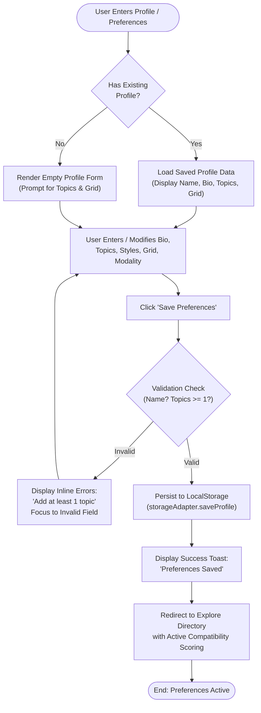
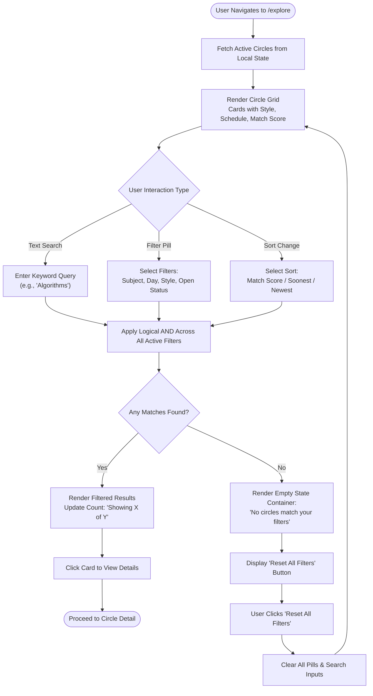
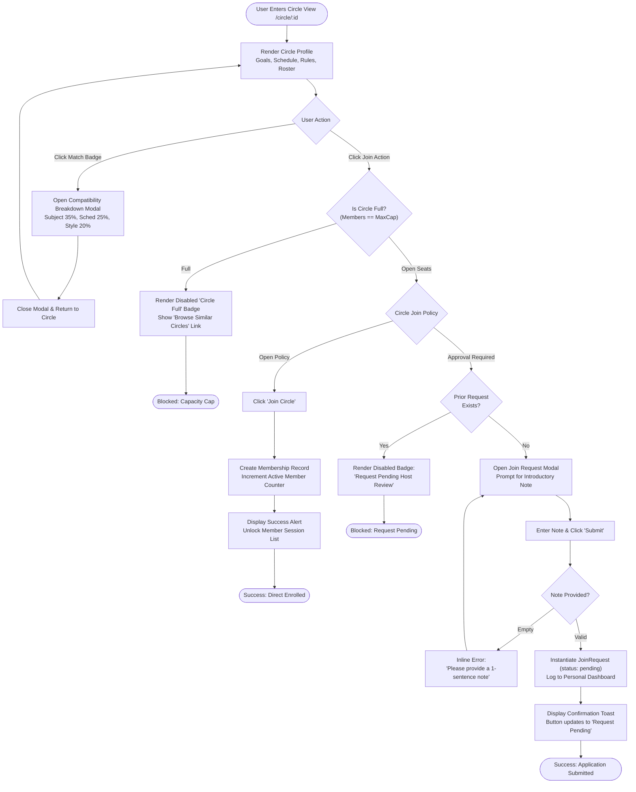
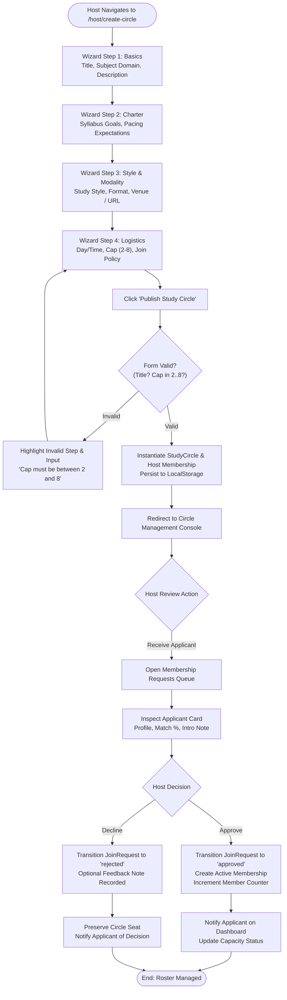
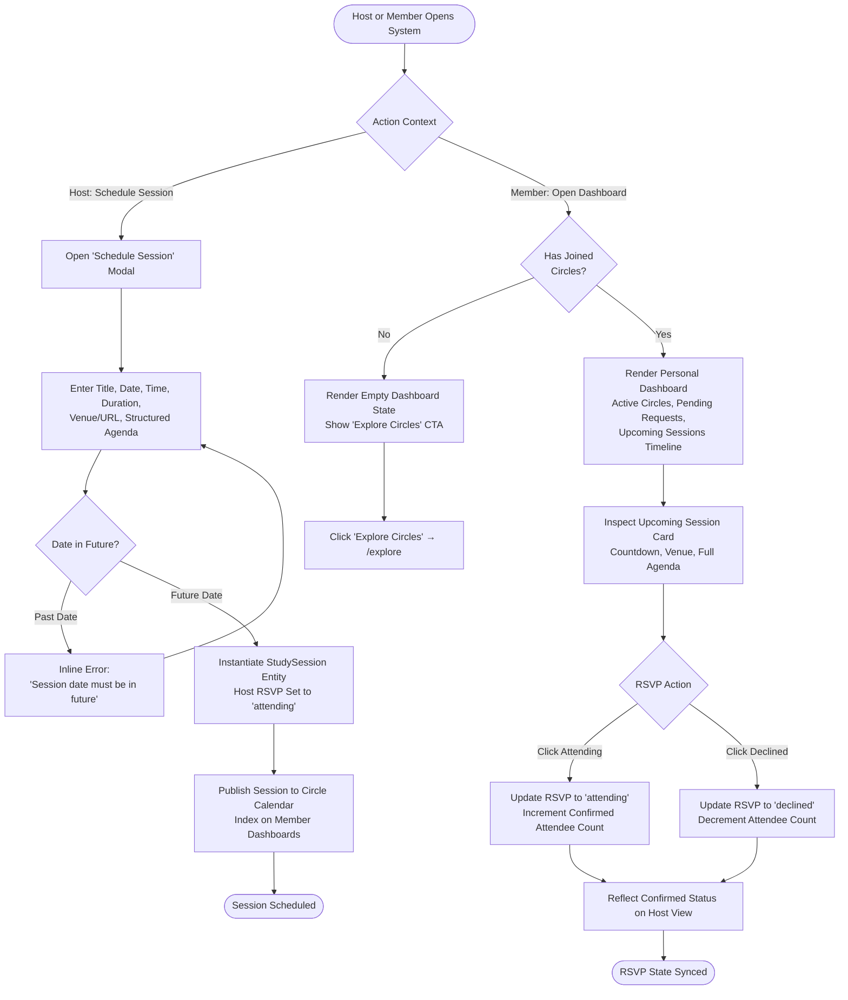

# Conceptual Wireflows & State Diagrams: CohortCircle

> **Governance Category:** Visual Interaction Modeling & State Transitions  
> **Status:** **FIVE INTERACTION WIREFLOWS SPECIFIED (WITH COMPLETE ERROR PATHS)**  
> **Integrity Notice:** These are conceptual interaction wireflows designed to validate error handling, decision forks, and recovery paths. They precede the low-fidelity interactive prototype scheduled for Module 05.

---

## Wireflow 01: Learner Profile & Study Preferences (`FLOW-01`)

---

## Wireflow 02: Explore Directory & Multi-Criteria Filtering (`FLOW-02`)

---

## Wireflow 03: Compatibility Inspection & Join / Request Workflows (`FLOW-03`)

---

## Wireflow 04: Host Circle Creation & Membership Moderation (`FLOW-04`)

---

## Wireflow 05: Session Scheduling, RSVP Tracking & Dashboard (`FLOW-05`)

