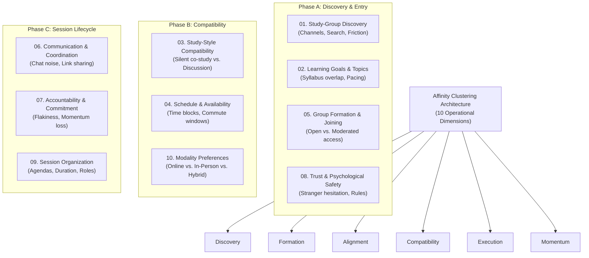

# Affinity Mapping & Thematic Clustering Framework: CohortCircle

> **Methodology:** Inductive-Deductive Qualitative Clustering (KJ Method Adaptation)  
> **Status:** **CLUSTERING FRAMEWORK INSTRUMENTED — EMPIRICAL CARDS PENDING FIELDWORK**  
> **Integrity Standard:** The 10 clustering categories below are analytical dimensions, NOT empirical discoveries. No synthetic quotations or fabricated interview snippets are inserted. The card schema is pre-wired to ingest authentic field records upon completion of Module 02 fieldwork.

---

## 1. Affinity Clustering Topology (10 Organizing Dimensions)

The affinity mapping framework organizes qualitative observations and interview excerpts into ten high-cohesion operational clusters:



---

## 2. Standardized Evidence Card Schema

Every qualitative card generated from transcripts (`INT-01` to `07`) or observation notes (`OBS-01` to `03`) must follow this standardized schema to ensure auditability:

```text
┌────────────────────────────────────────────────────────────────────────┐
│ AFFINITY CARD: [CARD-ID]                                              │
├────────────────────────────────────────────────────────────────────────┤
│ Evidence Source ID:    [INT-XX / OBS-XX / SUR-QXX]                     │
│ Source Method:         [Interview / Contextual Inquiry / Survey]       │
│ Participant / Site ID: [P-01 to P-07 / Central Library / etc.]         │
│ Initial Code:          [e.g., CODE-SCHED-FATIGUE]                      │
│ Assigned Cluster:      [Cluster 01 to 10]                              │
├────────────────────────────────────────────────────────────────────────┤
│ Verbatim Excerpt / Direct Observation (Raw Fact):                      │
│ "..."                                                                  │
├────────────────────────────────────────────────────────────────────────┤
│ Emerging Analytical Interpretation (Researcher Insight):               │
│ ...                                                                    │
├────────────────────────────────────────────────────────────────────────┤
│ Confidence Level:      [High / Moderate / Preliminary]                 │
│ Evidence Limitations:  [e.g., Self-reported recall bias]               │
└────────────────────────────────────────────────────────────────────────┘
```

---

## 3. Ten Cluster Definitions & Ingestion Registers

### Cluster 01: Study-Group Discovery
* **Scope:** How learners currently look for peers; campus hallways, large lecture chats, bulletin boards, and the social barriers to reaching out.
* **Pre-Fieldwork Hypothesis:** Students in large courses find it awkward and socially risky to broadcast study requests to hundreds of strangers.
* **Card Ingestion Table:**
| Card ID | Evidence Source | Participant ID | Raw Verbatim Excerpt / Observation | Analytical Interpretation | Confidence |
|---|---|---|---|---|---|
| *CARD-01-01* | `INT-01` *(Pending)* | `P-01` | *[Awaiting interview transcript]* | *[To be coded]* | `PENDING` |

---

### Cluster 02: Learning Goals & Subject Alignment
* **Scope:** Specificity of course subjects, chapter topics, problem sets, and expected target grades (e.g., passing vs. mastery).
* **Pre-Fieldwork Hypothesis:** Mismatched academic pacing (one member 2 weeks behind) cripples collaborative effectiveness.
* **Card Ingestion Table:**
| Card ID | Evidence Source | Participant ID | Raw Verbatim Excerpt / Observation | Analytical Interpretation | Confidence |
|---|---|---|---|---|---|
| *CARD-02-01* | `INT-02` *(Pending)* | `P-02` | *[Awaiting interview transcript]* | *[To be coded]* | `PENDING` |

---

### Cluster 03: Study-Style Compatibility
* **Scope:** Preferred working methods: Silent Co-Study, Collaborative Problem-Solving, Discussion-Based Learning, Peer Teaching, Exam Preparation.
* **Pre-Fieldwork Hypothesis:** Forcing a vocal debater and a silent co-worker into the same group creates immediate friction and disengagement.
* **Card Ingestion Table:**
| Card ID | Evidence Source | Participant ID | Raw Verbatim Excerpt / Observation | Analytical Interpretation | Confidence |
|---|---|---|---|---|---|
| *CARD-03-01* | `OBS-01` *(Pending)* | Library Site | *[Awaiting field observation notes]* | *[To be coded]* | `PENDING` |

---

### Cluster 04: Schedule & Availability
* **Scope:** Recurring weekly free blocks, commute time constraints, part-time job commitments, and scheduling fatigue.
* **Pre-Fieldwork Hypothesis:** Back-and-forth messaging to find a free 90-minute window is the single greatest administrative bottleneck.
* **Card Ingestion Table:**
| Card ID | Evidence Source | Participant ID | Raw Verbatim Excerpt / Observation | Analytical Interpretation | Confidence |
|---|---|---|---|---|---|
| *CARD-04-01* | `SUR-Q05` *(Pending)*| Survey Sample | *[Awaiting survey response dataset]* | *[To be coded]* | `PENDING` |

---

### Cluster 05: Group Formation & Joining Workflows
* **Scope:** Open circles vs. request-to-join with application notes; member caps (3–5 vs. 10+); onboarding mechanics.
* **Pre-Fieldwork Hypothesis:** Moderated circles provide higher commitment than uncurated, open-door chat groups.
* **Card Ingestion Table:**
| Card ID | Evidence Source | Participant ID | Raw Verbatim Excerpt / Observation | Analytical Interpretation | Confidence |
|---|---|---|---|---|---|
| *CARD-05-01* | `INT-05` *(Pending)* | `P-05` | *[Awaiting interview transcript]* | *[To be coded]* | `PENDING` |

---

### Cluster 06: Communication & Coordination
* **Scope:** Channel fragmentation across WhatsApp, Discord, Slack, and email; notification noise; lost meeting links and files.
* **Pre-Fieldwork Hypothesis:** When group chats veer into social chit-chat, members mute notifications and miss study session announcements.
* **Card Ingestion Table:**
| Card ID | Evidence Source | Participant ID | Raw Verbatim Excerpt / Observation | Analytical Interpretation | Confidence |
|---|---|---|---|---|---|
| *CARD-06-01* | `OBS-02` *(Pending)* | Lounge Site | *[Awaiting field observation notes]* | *[To be coded]* | `PENDING` |

---

### Cluster 07: Accountability & Commitment
* **Scope:** Peer accountability, flakiness, attendance drop-offs, and groups dissolving after one or two meetings.
* **Pre-Fieldwork Hypothesis:** Without clear recurring cadences or RSVP accountability, informal study groups experience 70%+ drop-off.
* **Card Ingestion Table:**
| Card ID | Evidence Source | Participant ID | Raw Verbatim Excerpt / Observation | Analytical Interpretation | Confidence |
|---|---|---|---|---|---|
| *CARD-07-01* | `INT-04` *(Pending)* | `P-04` | *[Awaiting interview transcript]* | *[To be coded]* | `PENDING` |

---

### Cluster 08: Trust, Privacy & Psychological Safety
* **Scope:** Fear of asking "dumb questions", hesitation in meeting strangers, need for clear conduct rules and de-identified profiles.
* **Pre-Fieldwork Hypothesis:** Learners require transparent expectations and host reputation before feeling safe enough to participate actively.
* **Card Ingestion Table:**
| Card ID | Evidence Source | Participant ID | Raw Verbatim Excerpt / Observation | Analytical Interpretation | Confidence |
|---|---|---|---|---|---|
| *CARD-08-01* | `INT-06` *(Pending)* | `P-06` | *[Awaiting interview transcript]* | *[To be coded]* | `PENDING` |

---

### Cluster 09: Session Organization & Agendas
* **Scope:** Setting concrete meeting agendas, assigning prep materials, defining time-boxed session intervals, and meeting wrap-ups.
* **Pre-Fieldwork Hypothesis:** Sessions with explicit agendas (e.g., "Solve Problems 1 to 4 in 60 mins") achieve significantly higher satisfaction.
* **Card Ingestion Table:**
| Card ID | Evidence Source | Participant ID | Raw Verbatim Excerpt / Observation | Analytical Interpretation | Confidence |
|---|---|---|---|---|---|
| *CARD-09-01* | `INT-03` *(Pending)* | `P-03` | *[Awaiting interview transcript]* | *[To be coded]* | `PENDING` |

---

### Cluster 10: Modality & Physical Environment
* **Scope:** In-person campus study vs. remote video calls vs. hybrid; seating layout, noise distractions, power outlets, Wi-Fi reliability.
* **Pre-Fieldwork Hypothesis:** Commuter students prioritize online sessions; residential students favor physical campus library zones.
* **Card Ingestion Table:**
| Card ID | Evidence Source | Participant ID | Raw Verbatim Excerpt / Observation | Analytical Interpretation | Confidence |
|---|---|---|---|---|---|
| *CARD-10-01* | `OBS-03` *(Pending)* | Cafeteria Site | *[Awaiting field observation notes]* | *[To be coded]* | `PENDING` |
