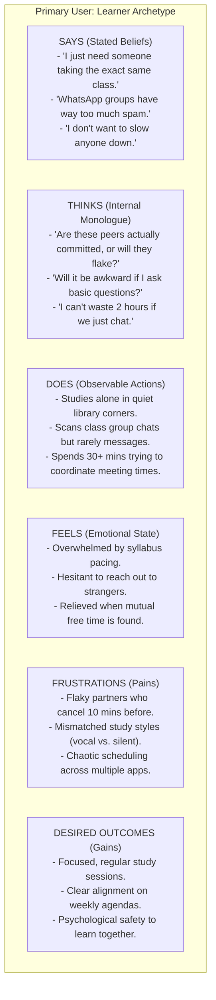
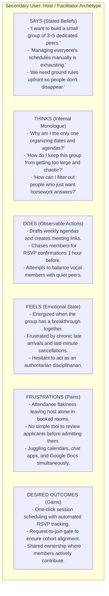

# Empathy Map Specifications: CohortCircle

> **Methodology:** Cognitive & Affective Behavioral Mapping  
> **Status:** **PROTO-EMPATHY MAPS (UNVALIDATED BASELINE — PENDING EMPIRICAL CONFIRMATION)**  
> **Traceability Notice:** In the absence of completed field records, empathy statements represent structured research hypotheses (`HYP-EM-XX`) anchored in initial problem analysis. These quadrants will be confirmed, refined, or replaced following empirical interview transcription.

---

## 1. Role A: Primary User — Learner / Student

* **Role Definition:** An undergraduate student or independent learner seeking peers to master challenging concepts, complete course exercises, or maintain regular study habits.
* **Provisional Baseline:** Balances intense course loads with competing personal obligations; often feels isolated in large classes.

### Detailed Learner Empathy Breakdown:

| Quadrant | Hypothesized Statement / Behavioral Signal | Hypothesis ID | Mapped RQ | Post-Fieldwork Verification Source | Status |
|---|---|---|---|---|---|
| **SAYS** | "I want a study buddy who actually wants to work, not just chat for an hour." | `HYP-EM-L01` | `RQ-01`, `RQ-04` | `INT-01`, `INT-02` | `HYPOTHESIS` |
| **SAYS** | "Finding a time when three of us are free feels almost impossible." | `HYP-EM-L02` | `RQ-03` | `INT-04`, `SUR-Q05` | `HYPOTHESIS` |
| **THINKS** | "What if I join this group and realize they are way ahead of me?" | `HYP-EM-L03` | `RQ-06`, `RQ-08` | `INT-06` | `HYPOTHESIS` |
| **THINKS** | "I hope this group has ground rules so we actually get through the problem set." | `HYP-EM-L04` | `RQ-05` | `INT-03` | `HYPOTHESIS` |
| **DOES** | Drops into campus library or lounge with headphones to signal focus. | `HYP-EM-L05` | `RQ-02`, `RQ-07` | `OBS-01`, `OBS-02` | `HYPOTHESIS` |
| **DOES** | Abandons class group chats when non-academic banter drowns out coordination. | `HYP-EM-L06` | `RQ-07` | `INT-01`, `INT-05` | `HYPOTHESIS` |
| **FEELS** | Anxiety when approaching unfamiliar classmates in 200+ student lecture halls. | `HYP-EM-L07` | `RQ-01`, `RQ-08` | `INT-06` | `HYPOTHESIS` |
| **FEELS** | Motivation and accountability when sitting beside someone focused on the same task. | `HYP-EM-L08` | `RQ-04` | `INT-01`, `OBS-01` | `HYPOTHESIS` |
| **PAINS** | Time wasted negotiating meeting times across fractured chat threads. | `HYP-EM-L09` | `RQ-03`, `RQ-07` | `SUR-Q05`, `INT-04` | `HYPOTHESIS` |
| **PAINS** | Showing up to a session only to find members unprepared or inattentive. | `HYP-EM-L10` | `RQ-05` | `INT-05`, `SUR-Q07` | `HYPOTHESIS` |
| **GAINS** | Transparent compatibility score that explains *why* a circle matches their schedule and habits. | `HYP-EM-L11` | `RQ-06`, `RQ-08` | `INT-01`, `SUR-Q08` | `HYPOTHESIS` |
| **GAINS** | Structured session agendas that keep collaborative time productive and time-boxed. | `HYP-EM-L12` | `RQ-05` | `INT-03`, `SUR-Q08` | `HYPOTHESIS` |

---

## 2. Role B: Secondary User — Study Circle Host / Facilitator

* **Role Definition:** An active student, peer tutor, or learning circle organizer who takes the initiative to convene and run a collaborative study group.
* **Provisional Baseline:** Motivated to lead; enjoys structured learning; bears the disproportionate cognitive burden of managing schedules, rooms, and attendance.

### Detailed Host Empathy Breakdown:

| Quadrant | Hypothesized Statement / Behavioral Signal | Hypothesis ID | Mapped RQ | Post-Fieldwork Verification Source | Status |
|---|---|---|---|---|---|
| **SAYS** | "I'm happy to facilitate, but I shouldn't have to beg people to tell me if they are showing up." | `HYP-EM-H01` | `RQ-02`, `RQ-05` | `INT-05` | `HYPOTHESIS` |
| **SAYS** | "A study group of more than 5 people turns into a lecture or a party; small is better." | `HYP-EM-H02` | `RQ-02` | `INT-05`, `SUR-Q08` | `HYPOTHESIS` |
| **THINKS** | "I need a way to vet people before admitting them so our study style isn't disrupted." | `HYP-EM-H03` | `RQ-06`, `RQ-08` | `INT-05` | `HYPOTHESIS` |
| **THINKS** | "If someone can't make the commitment, I'd rather know immediately so another peer can join." | `HYP-EM-H04` | `RQ-05` | `INT-05` | `HYPOTHESIS` |
| **DOES** | Books campus library study rooms or creates Google Meet links. | `HYP-EM-H05` | `RQ-02`, `RQ-07` | `OBS-01`, `INT-05` | `HYPOTHESIS` |
| **DOES** | Sends reminder messages across WhatsApp/Discord 2 hours before meetings. | `HYP-EM-H06` | `RQ-07` | `INT-05` | `HYPOTHESIS` |
| **FEELS** | Burden of being the sole responsible driver of group momentum. | `HYP-EM-H07` | `RQ-05` | `INT-05` | `HYPOTHESIS` |
| **FEELS** | Deep satisfaction when collaborative problem-solving leads to shared exam success. | `HYP-EM-H08` | `RQ-04` | `INT-05` | `HYPOTHESIS` |
| **PAINS** | Free-riders who seek completed assignment answers without contributing effort. | `HYP-EM-H09` | `RQ-04`, `RQ-05` | `INT-05` | `HYPOTHESIS` |
| **PAINS** | Disjointed tools: Polls on Doodle, chats on WhatsApp, files on Drive, meetings on Meet. | `HYP-EM-H10` | `RQ-07` | `INT-05`, `OBS-02` | `HYPOTHESIS` |
| **GAINS** | Circle creation wizard that enforces capacity limits and explicit study style tags. | `HYP-EM-H11` | `RQ-02`, `RQ-06` | `INT-05`, `SUR-Q08` | `HYPOTHESIS` |
| **GAINS** | Integrated session scheduler with member attendance status (Attending / Declined). | `HYP-EM-H12` | `RQ-03` | `INT-05` | `HYPOTHESIS` |
