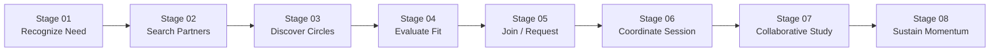

# End-to-End User Journey Map: CohortCircle

> **Methodology:** Customer Experience Journey Mapping (CX/UX Framework)  
> **Status:** **PROVISIONAL JOURNEY BASELINE (HYPOTHESIS-ALIGNED — PENDING EMPIRICAL CALIBRATION)**  
> **Traceability Notice:** Friction points and emotional states reflect current domain hypotheses (`HYP-01`, `HYP-EM-XX`). Emotional dip validation and time benchmarks will be calibrated against empirical interview transcripts and contextual inquiry logs.

---

## 1. Journey Architecture & Mermaid Flow

The complete lifecycle of a peer study group spans eight distinct chronological stages from initial need recognition to sustained accountability:

---

## 2. Emotional Valence & Systemic Touchpoint Curve

The typical journey in existing ad-hoc environments exhibits severe emotional troughs during discovery (Stage 2), compatibility evaluation (Stage 4), and session coordination (Stage 6):

| Stage | User Phase Description | Current Ad-Hoc Experience (Baseline) | Hypothesized Emotional Valence (-2 to +2) | Target CohortCircle Experience |
|---|---|---|---|---|
| **01** | Recognize Need for Study Group | Motivated to tackle hard material; realizes solo study is stalling. | `+1 (Hopeful)` | Immediate entry point with zero onboarding barrier. |
| **02** | Search for Potential Partners | Awkwardly scanning lecture hall; posting in noisy WhatsApp chat. | `-1 (Anxious / Hesitant)` | Structured directory with topic keyword search. |
| **03** | Discover Suitable Study Circles | Scouring scattered bulletin boards or buried Discord channels. | `0 (Neutral / Fatigued)` | Real-time multi-filter directory (modality, style, day). |
| **04** | Evaluate Compatibility | Guessing whether peer works silently or chats; unknown schedules. | `-2 (High Uncertainty)` | **Explainable Compatibility Score & Breakdown Modal.** |
| **05** | Join or Request Membership | Awkward DM: "Hey, can I join your group?"; fear of rejection. | `0 (Apprehensive)` | Direct join or structured request note with clear expectations. |
| **06** | Coordinate First Session | 30+ back-and-forth messages across Doodle, WhatsApp, and email. | `-2 (Coordination Burnout)` | **Built-in Session Scheduler with real-time RSVPs.** |
| **07** | Participate in Collaborative Study | Session happens; risk of mismatched pacing or unprepared peers. | `+1 (Productive Focus)` | Explicit session agendas and agreed study style norms. |
| **08** | Sustain Momentum & Routine | Group fizzles out after 1 meeting; no one schedules the next one. | `-1 (Disappointment)` | **Personal Study Dashboard with recurring calendar views.** |

---

## 3. Detailed Stage-by-Stage Journey Specifications

### Stage 01: Recognize the Need for Collaborative Learning
* **User Goal:** Overcome study procrastination, clarify difficult syllabus concepts, or prepare systematically for exams.
* **User Actions:** Identifies personal learning roadblocks in a course; realizes individual textbook/video review is insufficient.
* **Questions & Expectations:** *"Is anyone else finding this problem set impossible? Where do people in this class study?"*
* **Possible Friction (Hypothesized):** Academic self-doubt; imposter syndrome; reluctance to admit needing peer support.
* **Emotional State:** Concerned but motivated (`+1`).
* **Existing Workarounds:** Struggling alone until the night before the assignment is due; browsing Reddit or StackOverflow.
* **CohortCircle Product Opportunity:** Clear landing page messaging celebrating peer learning as an intellectual accelerator (`README.md`, `PROJECT_CHARTER.md`).
* **Traceability Hook:** `RQ-01`, `HYP-01`, `PROTO-LEARN-01`, `PROTO-LEARN-02`.

---

### Stage 02: Search for Potential Study Partners
* **User Goal:** Locate peers taking the exact same course or mastering the same domain.
* **User Actions:** Looks around the lecture hall; asks friends in personal contacts; posts in a 200-person general class chat.
* **Questions & Expectations:** *"Who in this 300-person lecture is actually looking for a serious study partner?"*
* **Possible Friction (Hypothesized):** Fear of cold outreach; noise-to-signal ratio in unmoderated group chats; introversion barriers.
* **Emotional State:** Social hesitation and friction (`-1`).
* **Existing Workarounds:** Posting generic messages in WhatsApp/Telegram that quickly get buried by meme sharing.
* **CohortCircle Product Opportunity:** Searchable circle directory filtered by subject domain, course keywords, and meeting formats (`FR-005`, `FR-006`, `FR-007`).
* **Traceability Hook:** `RQ-01`, `RQ-07`, `CODE-DISC-COLD`, `INT-01`, `INT-06`.

---

### Stage 03: Discover Suitable Study Circles
* **User Goal:** Identify active study groups that match their specific academic focus.
* **User Actions:** Browses available options; scans group descriptions and host profiles.
* **Questions & Expectations:** *"Is this circle active? Are they preparing for exams or doing weekly problem sets?"*
* **Possible Friction (Hypothesized):** Outdated listings; groups with ambiguous goals; groups that are already full.
* **Emotional State:** Cautious interest (`0`).
* **Existing Workarounds:** Scanning physical library bulletin flyers that have been pinned for three months.
* **CohortCircle Product Opportunity:** Active status indicators, member count badges (e.g., "3 / 5 members"), and last-active timestamps (`FR-005`, `FR-012`).
* **Traceability Hook:** `RQ-01`, `RQ-06`, `FR-005`, `FR-012`.

---

### Stage 04: Evaluate Compatibility & Expectations
* **User Goal:** Ensure mutual alignment in study methods, schedule availability, and group size before committing time.
* **User Actions:** Compares two or three candidate circles; inspects schedules, rules, and host expectations.
* **Questions & Expectations:** *"Do they study quietly or talk out loud? Do their meeting times conflict with my part-time job or commute?"*
* **Possible Friction (Hypothesized):** High cognitive overhead trying to cross-reference multiple syllabus calendars; fear of joining a mismatched group.
* **Emotional State:** High anxiety and uncertainty (`-2`).
* **Existing Workarounds:** Joining blind, showing up once, feeling frustrated by mismatch, and quietly ghosting.
* **CohortCircle Product Opportunity:** **Deterministic Compatibility Score & Explainable Breakdown Modal** (`FR-009`, `FR-010`). Transparently shows schedule overlap %, study style match %, and format alignment.
* **Traceability Hook:** `RQ-04`, `RQ-06`, `RQ-08`, `DEC-003`, `FR-009`, `FR-010`.

---

### Stage 05: Join or Request Membership
* **User Goal:** Gain entry into the selected study circle with minimal friction and clear expectations.
* **User Actions:** Clicks "Join Circle" (if open) or submits a join request with an introductory note explaining their goals.
* **Questions & Expectations:** *"Will the host accept me? What should I write in my intro note? How quickly will they respond?"*
* **Possible Friction (Hypothesized):** Fear of social rejection; complicated multi-step registration forms; prolonged silence from hosts.
* **Emotional State:** Expectant but vulnerable (`0`).
* **Existing Workarounds:** Awkward private messages on Instagram/WhatsApp: *"Hey, can I study with you guys?"*
* **CohortCircle Product Opportunity:** Direct join for open groups (`FR-013`); structured, low-stress request form with goal prompts (`FR-014`); host moderation dashboard (`FR-018`).
* **Traceability Hook:** `RQ-02`, `RQ-08`, `FR-013`, `FR-014`, `FR-018`.

---

### Stage 06: Coordinate the First Study Session
* **User Goal:** Establish a concrete date, time, duration, location/link, and agenda for the initial study session.
* **User Actions:** Negotiates free time slots with peers; checks room availability or generates video links.
* **Questions & Expectations:** *"When is everyone free? Where are we meeting? What specific problem set are we working on?"*
* **Possible Friction (Hypothesized):** Extreme scheduling fatigue; 30+ message threads; someone unable to make the time; forgotten meeting links.
* **Emotional State:** Severe coordination burnout (`-2`).
* **Existing Workarounds:** Juggling Doodle polls, Google Calendar invites, and WhatsApp group announcements simultaneously.
* **CohortCircle Product Opportunity:** **Integrated Session Scheduler with Agenda & RSVP Tracking** (`FR-020`, `FR-021`). Host publishes session; members mark Attending/Declined with one click.
* **Traceability Hook:** `RQ-03`, `RQ-07`, `CODE-SCHED-FATIGUE`, `FR-020`, `FR-021`.

---

### Stage 07: Participate in Collaborative Study
* **User Goal:** Experience an effective, focused, and enjoyable collaborative learning session.
* **User Actions:** Attends the session; executes study tasks according to the agreed format (silent co-study, problem sets, or debate).
* **Questions & Expectations:** *"Are we sticking to the agenda? Is everyone participating equitably?"*
* **Possible Friction (Hypothesized):** Distractions; dominant voices interrupting; unprepared members asking to copy answers; ambient room noise.
* **Emotional State:** Relieved and productive (`+1`).
* **Existing Workarounds:** Wearing headphones while sitting next to someone; awkward silence when conversation dies.
* **CohortCircle Product Opportunity:** Explicit circle charters and session agendas displayed at the top of the session view (`FR-012`, `FR-020`).
* **Traceability Hook:** `RQ-04`, `RQ-05`, `OBS-01`, `OBS-02`, `OBS-03`.

---

### Stage 08: Sustain Momentum & Accountability
* **User Goal:** Maintain weekly study cadence and ensure the study circle persists throughout the academic semester.
* **User Actions:** Evaluates session outcome; confirms attendance for the next upcoming session; reviews progress.
* **Questions & Expectations:** *"Are we meeting again next week? Who is leading next Tuesday's session?"*
* **Possible Friction (Hypothesized):** Post-midterm drop-off; lack of recurring habit; informal groups dying out after 1–2 meetings.
* **Emotional State:** Fragile; risk of drop-off without structure (`-1`).
* **Existing Workarounds:** Hoping someone randomly sends a message in the chat two weeks later.
* **CohortCircle Product Opportunity:** **Personal Study Dashboard** (`FR-022`) with chronological upcoming sessions, recurring meeting schedules, and membership roster status.
* **Traceability Hook:** `RQ-05`, `CODE-MOMENTUM-DROP`, `FR-022`.
